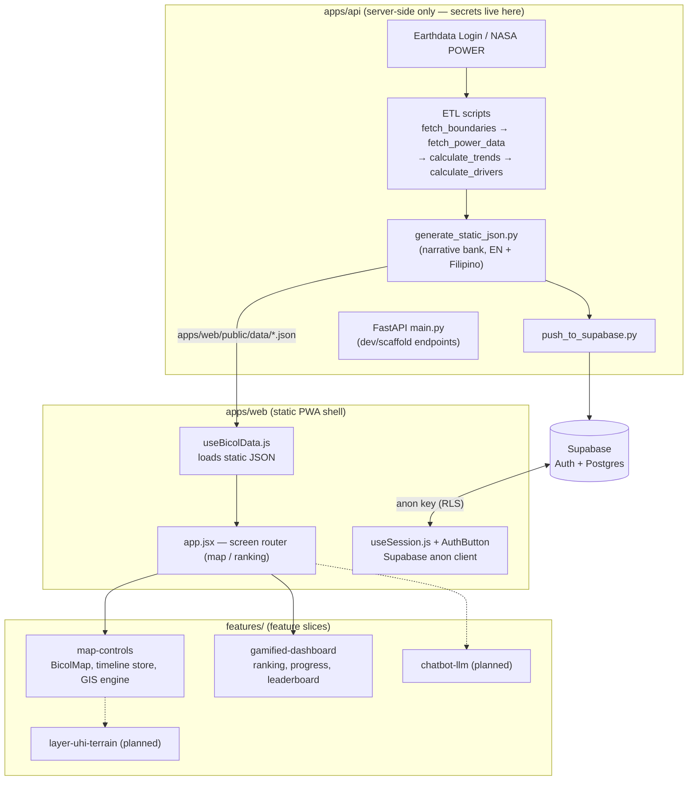

<!-- generated-by: gsd-doc-writer -->
# Architecture

## System overview

Bicol In-Heat is a heat-trend detective tool for Bicol (Region V, Philippines): which municipalities are heating, how fast, why, and whether the trend is statistically significant. It is built as a **static PWA + offline-first data pipeline**: a Python ETL pipeline pulls NASA/PAGASA data server-side, computes Theil–Sen slopes, Mann–Kendall significance, Rothfusz heat index, and RF/SHAP driver rankings, and emits static JSON that a Vite + React + Tailwind PWA consumes with no runtime backend in the client path. Supabase (Auth + Postgres) provides optional accounts, saved places, and a leaderboard behind an anon key; all secrets stay in `apps/api/.env`. The LLM narration is build-time only — it renders computed numbers into the narrative bank and never generates numbers. The one runtime exception is the QA chatbot's server-side `POST /api/qa` endpoint (promoted to CORE 2026-11-13); its Azure OpenAI key lives in `apps/api/.env` and the browser never sees it.

## Component diagram



## Data flow

1. **Extract** — `fetch_boundaries.py` pulls geoBoundaries `adm3` municipality polygons (interim boundary source; swap for PSA/PSGC when confirmed); `fetch_power_data.py` pulls NASA POWER daily T2M + RH2M (no auth required). Landsat C2 L2, MOD44B.061, MCD12Q1.061 and ECOSTRESS pulls use Earthdata Login credentials from `apps/api/.env`.
2. **Compute** — `calculate_trends.py` derives per-municipality Rothfusz heat index series (1981–2025 baseline), Theil–Sen slope + Mann-Kendall test at α = 0.05 → `significant` flag; `calculate_drivers.py` builds driver features (elevation, distance to coast, wind, canopy, land cover, LST) and ranks them with Random Forest / SHAP — reported as association, not causation. Both write `apps/api/output/trends.json` etc. (generated dirs, not committed).
3. **Render narrative** — `generate_static_json.py` injects those computed numbers into EN + Filipino templates (PAGASA bands: Caution 27 °C, Extreme Caution 33 °C, Danger 42 °C, Extreme Danger 52 °C) and writes `narratives.json`. Province-qualified `slugify(name, province)` gives unique keys across the 114 LGUs.
4. **Publish** — `push_to_supabase.py` writes results to Supabase with the service-role key (server-side only). Static assets are copied into `apps/web/public/data/` (`bicol-municipalities.geojson`, `narratives.json`) — the cross-boundary hand-off point: pipeline writes, web reads.
5. **Consume** — `useBicolData.js` fetches both JSON files in parallel and exposes `{ geojson, narratives, coverage, status }`. `app.jsx` mounts `BicolMap` (map screen) or `RankingScreen` (ranking screen) and threads data plus the Supabase session through. `engine.js` joins narratives onto GeoJSON features via the province-qualified `joinKey(name, province)` (a bare-name join is a known bug — "Bato" and "San Fernando" exist in two provinces).
6. **Persist (optional)** — `useSession.js` creates the Supabase anon client from `VITE_SUPABASE_URL` / `VITE_SUPABASE_ANON_KEY` (missing vars degrade the sign-in button, never crash the tree). Saved places (`savedStore.js`, exact-match `savedKey`) and the leaderboard (`leaderboardStore.js`, user-chosen handle only) read/write Postgres under RLS. Leaderboard reads `public.leaderboard` live; `LEADERBOARD_ENABLED` in `Leaderboard.jsx` is the kill switch back to the coming-soon placeholder.

## Key abstractions

| Abstraction | Location | Purpose |
|---|---|---|
| `BicolMap` (default export) | `features/map-controls/src/BicolMap.jsx` | Persistent single GeoJSON Leaflet layer; in-place style updates — never remount 114 features |
| `timelineStore` / `createTimelineStore` | `features/map-controls/src/state/timelineStore.js` | Singleton store for time scrubber, view mode, layer toggles; `canToggleLayer` guards the layer-registry seam |
| GIS engine functions (`joinKey`, `joinNarratives`, `getMunicipalityStyle`, `featureKey`) | `features/map-controls/src/gis/engine.js` | Feature identification, narrative joining, significance-as-border-pattern styling |
| `yearRamp` color ramps (`YEAR_*`, `TREND_*`) | `features/map-controls/src/gis/yearRamp.js` | The only two color sources in the app — no component may invent a local ramp |
| `rankMunicipalities` | `features/gamified-dashboard/src/ranking.js` | Slope/danger-band ordering; flags non-significant rows instead of filtering them |
| `savedStore` (`listSaved`/`addSaved`/`removeSaved`) | `features/gamified-dashboard/src/savedStore.js` | Supabase-backed saved places keyed by `name|province` |
| `progressStore` (`createProgress`, `derive`) | `features/gamified-dashboard/src/progressStore.js` | Local-only XP/streak/quests progress (h30 fallback: no auth required) |
| `useBicolData` | `apps/web/src/useBicolData.js` | Single static-JSON loader + coverage stats for all screens |
| `supabase` / `supabaseConfigured` | `apps/web/src/lib/supabase.js` | Null-safe anon client — configuration failure degrades, never throws |
| `generate_static_json` pipeline (`slugify`, `danger_band`, `BANDS`) | `apps/api/generate_static_json.py` | Build-time narrative bank; numbers injected from trends output only |

## Directory structure rationale

```
apps/web/                 Vite + React + Tailwind PWA shell — screen routing, auth,
                          static-JSON loader. Owns the client bundle: zero keys, zero passwords.
apps/api/                 Python server side — the ONLY place server secrets are read.
                          ETL scripts run in order: fetch_boundaries → fetch_power_data →
                          calculate_trends → calculate_drivers → generate_static_json →
                          push_to_supabase. FastAPI main.py provides dev endpoints.
core/                     Intended home of the shared trend engine (Theil–Sen,
                          Mann–Kendall, Rothfusz, RF/SHAP); currently empty — the math
                          lives in apps/api/calculate_*.py until it is extracted.
features/                 Vertical feature slices, each with its own AGENTS.md
                          sub-contract: map-controls (built), gamified-dashboard (built),
                          layer-uhi-terrain (contract only), chatbot-llm (contract only).
                          Mounted by apps/web via the @features Vite alias, never edited
                          by the web shell.
supabase/migrations/      Postgres schema: profiles, saved municipalities, top drivers.
graphify-out/             Generated code-graph output — not product code.
CONCEPT.md / AGENTS.md    Concept + decision log and team write-boundary rules (lead-owned).
```

The slice layout enforces the write-boundary contract: each agent writes only inside its own directory, cross-boundary needs go through the lead, and `apps/web` mounts feature components without editing them (Vite `resolve.alias` maps `@features` and `@core` outside `apps/web`, with bare deps like `react` and `leaflet` pinned into `apps/web/node_modules` so the out-of-tree features resolve a single copy).

**Build vs runtime split:** everything expensive or secret-bearing (Earthdata auth, RF/SHAP, LLM rendering) happens at build time in `apps/api`; the deployed artifact is static files plus an optional Supabase connection — which is what makes the offline last-view PWA possible.
